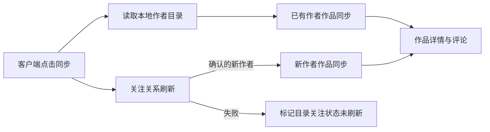

# Signal Desk 关注发现与增量同步路线优化方案

> 设计日期：2026-09-24 
> 状态：设计稿，供下一窗口实施；本轮不修改连接器、任务调度或正式数据库。 
> 依据：用户明确要求客户端一次点击启动、自动发现关注、保存作者导航信息，后续从已保存作者主页继续同步；R8 隔离报告和 `ai-boshu-crawler` 固定提交 `57ad263c0be8cf234bcadbc5c07dedc72304d182` 的只读审查。

## 1. 用户实际操作路径

### 首次使用或本地还没有可用作者清单

1. 用户在客户端确认采集范围并点击“同步”。客户端连接现有浏览器登录会话，定位当前账号主页，读取本人关注列表。用户无需粘贴博主 URL。已独立确认的关注项可以先进入目录并服务本次有限范围采集；若关注列表未完整翻页，整体发现状态仍为“部分完成”。
2. 系统把每位真实关注博主的公开 `uid`、`sec_uid`、规范主页 URL、昵称、关注关系来源和发现时间组成作者目录。`uid` 用来核对作品作者；`sec_uid` 用来导航主页及请求 `sec_user_id`。两者不互相填充。
3. 系统从该目录选择本次范围内的作者，按已保存的 `sec_uid`/主页读取作品列表，再读取选中作品详情与评论。首页、关注页和每位作者主页都不因为每条作品重复打开。
4. 客户端展示“作者发现”和“作品同步”各自的成功、部分完成或失败状态，以及本次取得的真实作品、评论、耗时和可复核来源。只有经过目标与响应归属核对的数据才能进入正式结果。

### 后续同步

1. 用户再次点击“同步”。系统先加载已验证的作者目录，直接为最近一次完整刷新确认关注、且身份仍有效的作者排作品任务；这些任务不等待新的关注列表完成。上次刷新失败而标为 `stale` 的作者沿用上次可信的关注关系继续采集，并明确显示状态过期；已确认取关或身份冲突的作者不自动采集。浏览器执行顺序优先从已保存作者开始，不以重新导航本人主页作为这批任务的起点。
2. 同一轮同步中另设“关注关系刷新”任务，用当前账号主页发现新关注，并更新已有作者信息。可以在已知作者任务后执行，或使用独立 tab 执行；共享登录上下文但不让两个导航任务争用同一 tab。新作者进入作者目录后可在本轮剩余配额内采集，或排入下一轮；任务状态必须明确显示实际选择。
3. 关注刷新失败时，已知作者的作品任务继续完成。目录显示“关注状态未刷新”，不得把未出现的作者判为取关，也不得将旧关注列表伪装成今天的新发现。
4. 作者作品任务独立保存结果及检查点。单个作者或单个作品失败，只影响该目标；严重身份错配、跨作品评论、凭据泄漏或写请求阻断该批次的正式验收，已成功目标的隔离证据仍保留供诊断。

### 新增和取消关注

- **新增关注**：从已独立确认关注关系和 `uid/sec_uid` 的响应项自动加入目录，保留首次发现时间；整份关注列表尚未闭合时，目录仍标“关注刷新部分完成”。无需用户手工添加。
- **取消关注**：仅当同一 owner 的关注列表**完整翻页、目标关系字段可信、且本次刷新没有失败**时，才把目录中本次缺席的旧作者标为“不再关注”。不删除作者、作品或历史证据。部分页、范围截断、登录失效、频控或 schema 变化均不触发批量取关。
- **重新关注**：同一 `uid`/`sec_uid` 配对恢复活动状态，保留历史作者主键与作品关系；若配对变化，先进入身份冲突待核对状态，不自动合并账号。

## 2. 三种任务及依赖关系

| 任务 | 输入 | 成功产物 | 失败影响 |
|---|---|---|---|
| `owner.resolve` / `following.refresh` | 当前已登录账号与只读浏览器会话 | owner 身份、完整或明确部分的关注快照、作者增量 | 阻断本轮新作者发现；已有作者作品可继续 |
| `creator.works.sync` | 已保存且验证过的 `{uid, secUid, profileUrl}`、上次作品检查点 | 该作者新增/更新作品、详情核对、独立检查点 | 只影响该作者；不重跑 owner 发现 |
| `work.comments.sync` | 原生 `aweme_id` 与作品作者绑定 | 一级评论、可选回复、覆盖状态与独立检查点 | 只影响该作品评论；作品元数据仍保留并标注评论未完成 |

首次无作者目录时，`following.refresh` 是作品任务的必要前置；目录已经建立时，它是同一轮的独立刷新任务。运行队列按 owner、作者、作品和评论分别有状态；不能用一个全局布尔值掩盖局部结果。同步范围上限与关注列表的完整性是两件事：允许只处理 24 个作品，但“只抓了前几页关注”不能称作完整关注快照。

## 3. 浏览器会话与采集执行

1. 在当前已登录的浏览器中复用一次授权会话；启动前检查 owner 是否与目录所属 owner 一致。owner 改变时隔离本轮，禁止把另一账号的关注关系覆盖当前目录。
2. `following.refresh` 需要导航到当前账号主页并触发本人关注列表。已知作者的 `creator.works.sync` 直接以目录中的 `sec_uid`/主页启动，不经过 owner 主页和关注页。一次 run 复用浏览器执行上下文；不为每条作品创建 tab 或重新 attach。
3. 优先使用经真实验证的只读结构化 GET：关注列表、作者作品列表、作品详情、一级评论和回复各自独立分页。浏览器内处理 Cookie 与必要签名；控制器和持久化层只接收白名单业务投影与安全诊断。签名能力必须以真实多页响应验证；不能仅凭 HTTP 200 或合成测试宣称可用。
4. 请求参数由已验证的页面/接口行为产生。关注列表实际可能使用 `offset`、时间边界或其他字段；不得先假定某字段必然是“下一页游标”。每个 endpoint 明确记录本次使用的请求分页字段、响应字段、推进规则和退出条件。重复响应、重复原生 ID、空页且 `has_more=true`、游标不进或页数上限都保留具体诊断，并标为部分/失败，不虚构闭合。
5. 作者关系按身份命名空间核对：关注 `uid` ↔ 列表/详情 `author.uid`；关注 `sec_uid` ↔ 主页路由/请求 `sec_user_id`，并在响应提供时核对 `author.sec_uid`。作品按原生 `aweme_id`，评论按原生 `cid` 与响应 `aweme_id` 绑定；回复单独核对 root/parent。
6. 小并发有界执行详情和评论，处理 429/`Retry-After`、登录失效及安全验证时暂停相应会话任务。没有吞吐实测前不承诺几分钟完成；报告实际请求数、成功数、失败数、总耗时、p50/p95。

DOM 可用于触发导航或做页面可见内容的 shadow 对照。正式作者关系、作品归属、互动指标和评论归属必须来自可验证的结构化响应。若某 endpoint 当天不可用，返回明确缺口；不把页面正文或候选链接升格为同等证明。媒体、ASR/OCR 和云核验仍是独立的显式流程。

## 4. 作者目录与持久化模型

当前 `creators` 只有 `platform_creator_id` 与 `profile_url`，不足以同时保存 `uid` 和 `sec_uid`。设计上的最小增量：

- 保持现有作者内部主键和历史 `platform_creator_id` 语义可追溯；新增独立 `sec_uid`、`identity_verified_at`、`identity_source`、`following_verified_at` 与 `following_state`（`active`、`stale`、`unfollowed`、`identity_conflict`）。`stale` 表示刷新结果过期，不等于取关；要保留上次可信关系与其时间。规范主页 URL 从验证过的 `sec_uid` 构造或校验，不能从 `uid` 拼成主页。
- owner 身份也需保存可验证的 `sec_uid` 或等效浏览器上下文绑定；作者目录按 owner 隔离。不能把已有 `local-owner-account:1` 文本当成真实平台 owner ID。
- 关注刷新分两个提交边界：已独立确认的正向关注项可幂等 upsert；只有完整快照经校验后，才在同一事务中更新缺席作者的取关状态。完整快照失败时不批量修改 `is_following`。保留发现时间、最近验证时间和最后一次成功刷新 ID，支持后续审计。
- 作者作品检查点按作者 `uid + sec_uid` 与适配器版本归属；评论检查点按 `aweme_id` 与 endpoint 归属。分页状态记录 `complete`、`scope-limited`、`partial`、`blocked`，不可把达到数量上限写成自然分页完成。
- 现有 SQLite 已正式迁移到 schema v5。本方案**不执行新的正式 migration**；实施窗口先写迁移与回滚审计，并在任何正式迁移前沿用“完整备份、只读前置核验、迁移后核验”的独立批准流程。

迁移必须明确处理旧行：有可验证 `sec_uid` 的历史作者可升级；只有旧 `platform_creator_id` 和 URL、但无法证明二者关系的作者应进入待核对状态，仍可展示历史资料，不能自动用于正式新采集或标取关。不得根据昵称或 URL 猜 `uid`。

## 5. 失败报告必须足以定位问题

每次 run 生成一个可追踪的总览和按任务/请求的结构化摘要。失败至少包含：`runId`、任务和目标类型、安全的目标公开 ID、endpoint/route、阶段（准备／请求／HTTP／JSON／平台状态／schema／身份／分页／持久化）、HTTP 状态、平台状态类别、请求页序号、**请求分页字段与数值类别**、响应分页字段与数值类别、`has_more`、返回条数、重复 ID 数、schema 指纹、白名单投影 hash、耗时、重试次数与准确的错误码。数值是否允许落盘由脱敏白名单决定；无法安全记录时至少保留“缺失／相同／前进／回退”类别。错误码不得截断掉 endpoint 名称。

报告不记录 Cookie、Authorization、签名值、完整带 query 的 URL、原始响应体或未白名单化的页面内容。目标 route 的错误与无关 Network 噪声分开记录。归属错误必须能追溯到**哪一个观察字段**与**哪一个目标字段**不一致，且不能把目标值回填成观察值。每次失败先用这些证据定位；报告不足时先修诊断，不猜测接口行为并要求用户重装扩展。

## 6. 实施顺序与验收门

1. **先冻结现状与证据**：保留现有失败 run，不改写状态；记录新旧代码边界与项目研究。旧逐页生产桥、隔离批量 PoC、正式任务队列不是同一套已完成产品能力。
2. **先打通真实执行协议**：在稳定复用的浏览器会话中验证 owner、已知作者作品、详情、评论各自的只读 GET、签名与多页退出；先把请求/响应分页规则和失败诊断做清楚，再定证明合同。用一次完整真实 run 验证执行路径，而非每个合成测试通过就要求重新安装。
3. **实现作者目录与任务解耦**：先用临时测试库与升级 fixture 验证 `uid != sec_uid`、旧数据迁移、owner 隔离、新关注/取消关注，以及关注刷新失败时已有作者仍能同步。保持正式能力门关闭。
4. **T2 shadow**：新独立隔离 run 处理 6 个真实作品，逐项列出结构化结果、失败和页面可见差异。结构化成功与人工 shadow 复核分开标记；目前 T2 报告为 `0/6、T2_BLOCKED`，不能沿用为通过。
5. **T3 acceptance**：按路线图从自动发现的真实关注账号中抽取 20～30 个、默认 24 个作品，单账号最多 3 个；保留原生 ID、作者、评论、分页、敏感信息与人工抽检硬门槛，同时验收第二轮从已保存作者目录直接同步，以及新关注自动发现。记录真实吞吐，不以合成 100 作品测试代替。
6. **上线准备**：只有 T2/T3 按新路线通过后，才提出正式数据库迁移和生产能力门切换的具体变更供单独批准。上线后也应支持“发现失败但已知作者同步成功”的明确部分成功状态。

## 7. 与现有文档的关系

本文件修正此前 [`R8 采集路线纠正`](r8-acquisition-route-correction-2026-09-24.md)中“每轮先完整抓关注，再批量抓作品”的隐含依赖，并修正原路线图中把 `uid` 与 `sec_uid` 当成同一个值的“四 ID 一致”表述。R8 对真实关注来源、独立作者证明、评论归属、安全与人工验收的要求继续有效，但应在正确的身份命名空间和可运行的采集协议上实现。`ai-boshu-crawler` 提供 CDP 会话复用、从已知作者出发、页面内签名、独立产物和准确报告覆盖缺口的参考；其抖音主流程与独立评论工具的能力边界不得混称为完整自动关注同步。
