# 云端Qwen3.5-4B逐帧原始读取结果

来自APP已保存的同次结果。文字、描述与不确定项均原样保留；下方图片为提交给硅基流动的原帧。

## 0.000秒 · sf-frame-1

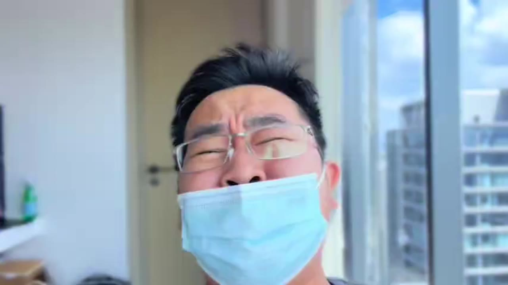

画面文字：

（模型返回空文本）

画面描述：

一名戴眼镜和口罩的男子面部特写，背景为室内环境，窗户可见。

不确定项：
[]

## 6.967秒 · sf-frame-2

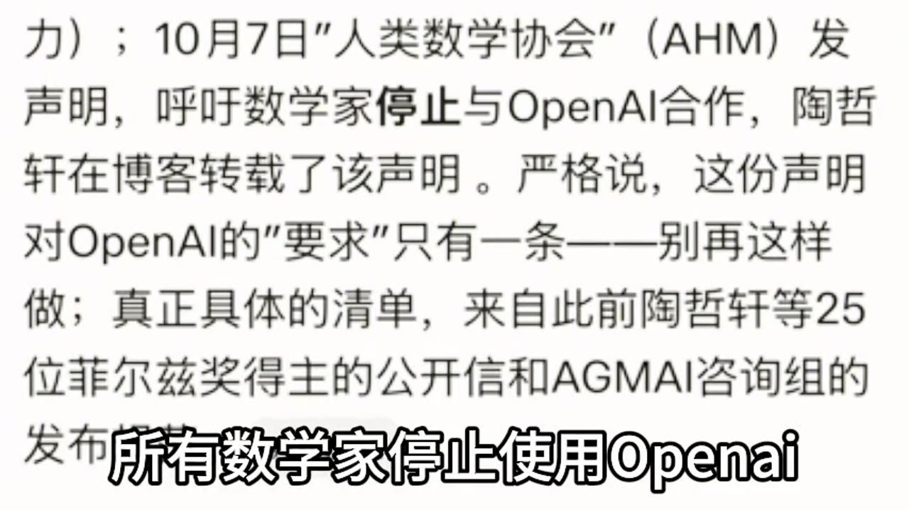

画面文字：

```text
力）；10月7日“人类数学协会”（AHM）

声明，呼吁数学家停止与OpenAI合作，陶哲轩在博客转载了该声明。严格说，这份声明

对OpenAI的“要求”只有一条——别再这样

做；真正具体的清单，来自此前陶哲轩等25

位菲尔兹奖得主的公开信和AGMAI咨询组的

发布

所有数学家停止使用Openai
```

画面描述：

屏幕显示一段关于数学家协会声明的中文文本，底部有强调文字。

不确定项：
[]

## 13.933秒 · sf-frame-3

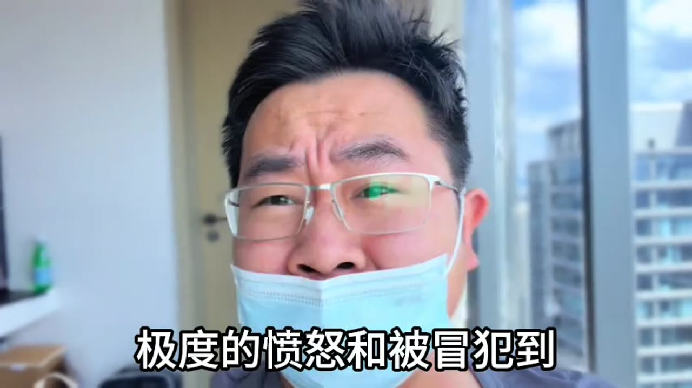

画面文字：

```text
极度的愤怒和被冒犯到
```

画面描述：

一名戴眼镜和口罩的男子面部特写，背景为室内环境，窗户可见。

不确定项：
[]

## 20.900秒 · sf-frame-4

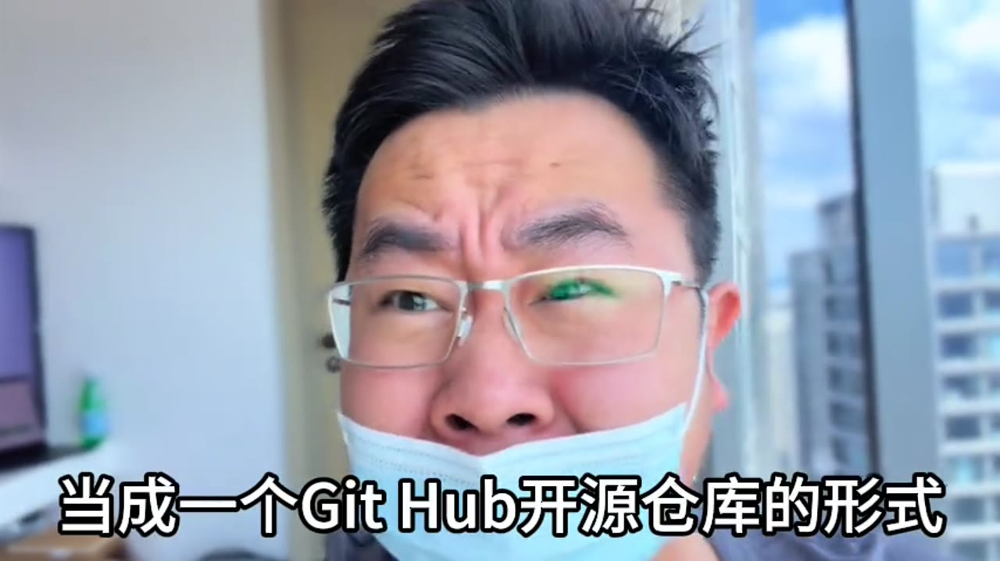

画面文字：

```text
当成一个Git Hub开源仓库的形式
```

画面描述：

一名戴眼镜和口罩的男子面部特写，背景为室内环境，窗外可见城市建筑。画面下方有白色中文字幕。

不确定项：
[]

## 27.867秒 · sf-frame-5

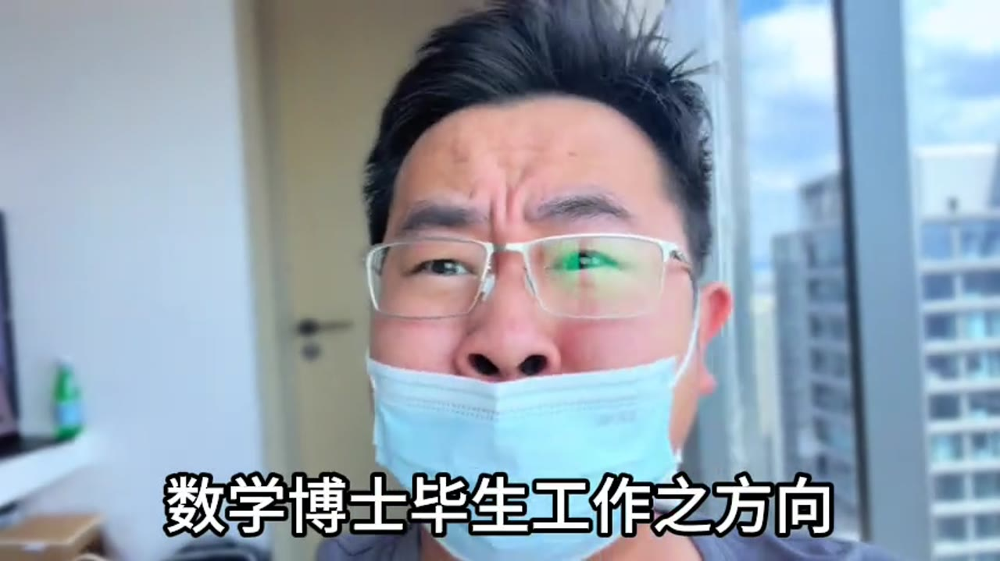

画面文字：

```text
数学博士毕生工作之方向
```

画面描述：

一名戴眼镜和口罩的男子面部特写，背景为室内环境，窗外可见城市建筑。画面下方有白色中文字幕。

不确定项：
[]

## 34.833秒 · sf-frame-6

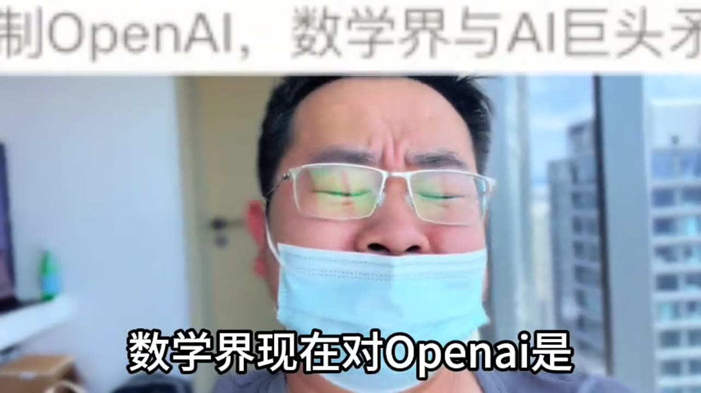

画面文字：

```text
制OpenAI，数学界与AI巨头矛
数学界现在对Openai是
```

画面描述：

一名戴眼镜和口罩的男子面部特写，背景为室内环境，窗外可见城市建筑。画面上方和下方有白色中文字幕。

不确定项：
[]

## 41.800秒 · sf-frame-7

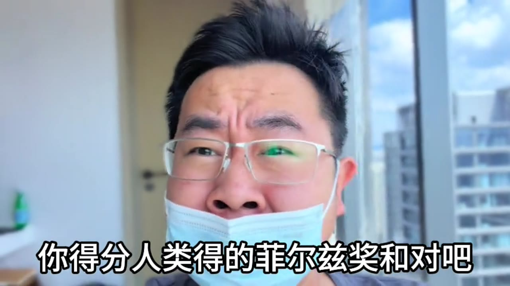

画面文字：

```text
你得分人类得的菲尔兹奖和对吧
```

画面描述：

一名戴眼镜和口罩的男子面部特写，背景为室内环境，窗外可见城市建筑。画面下方有白色中文字幕。

不确定项：
[]

## 48.766秒 · sf-frame-8

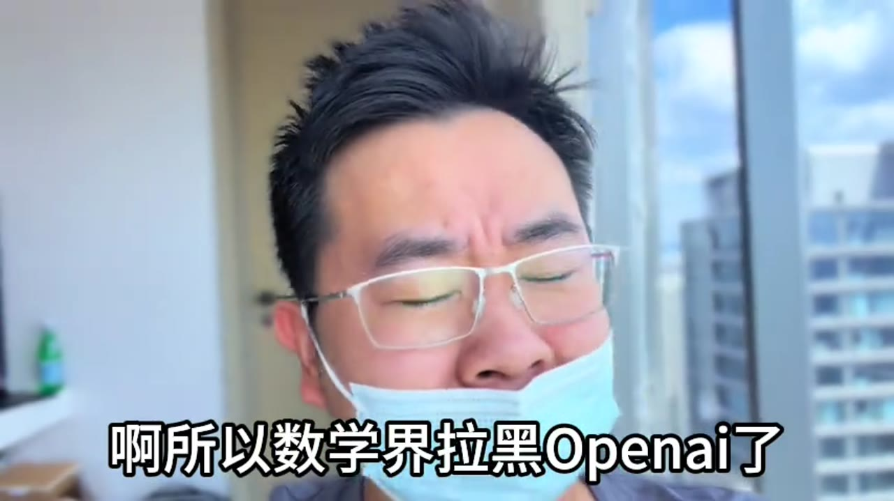

画面文字：

```text
啊所以数学界拉黑Openai了
```

画面描述：

一名戴眼镜和口罩的男子面部特写，背景为室内环境，窗外可见城市建筑。画面下方有白色中文字幕。

不确定项：
[]

## 55.733秒 · sf-frame-9

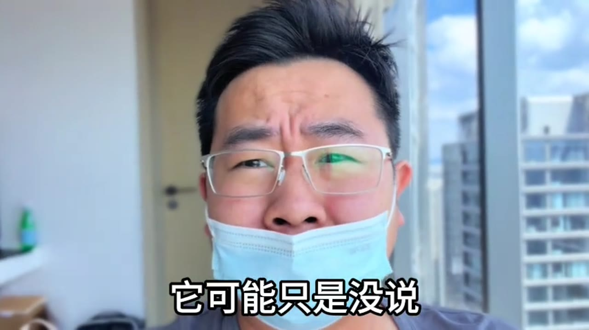

画面文字：

```text
它可能只是没说
```

画面描述：

一名戴眼镜和口罩的男子面部特写，背景为室内环境，窗外可见城市建筑。画面下方有白色中文字幕。

不确定项：
[]

## 62.700秒 · sf-frame-10

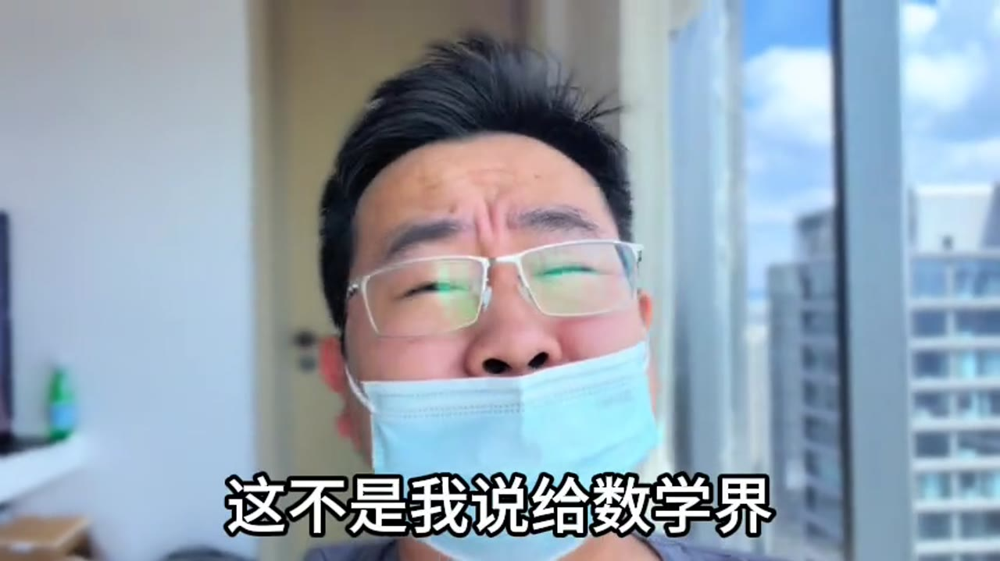

画面文字：

```text
这不是我说给数学界
```

画面描述：

一名戴眼镜和口罩的男子面部特写，背景为室内和窗外建筑，画面下方有白色中文字幕。

不确定项：
[]

## 69.666秒 · sf-frame-11

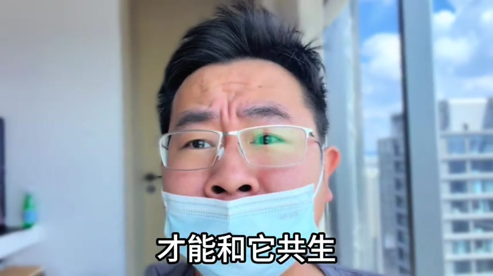

画面文字：

```text
才能和它共生
```

画面描述：

一名戴眼镜和口罩的男子面部特写，背景为室内和窗外建筑，画面下方有白色中文字幕。

不确定项：
[]

## 76.633秒 · sf-frame-12

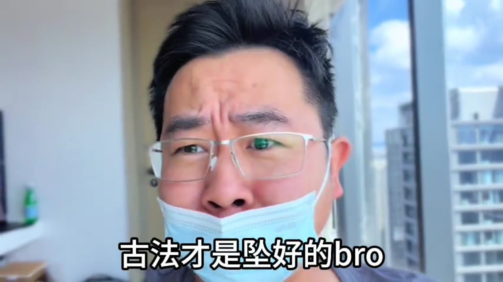

画面文字：

```text
古法才是坠好的bro
```

画面描述：

一名戴眼镜和口罩的男子面部特写，背景为室内和窗外建筑，画面下方有白色中文字幕。

不确定项：
[]
