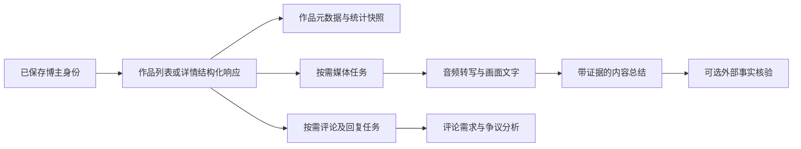

# 视频信息提取与内容结构化总结：参考实现研究

> 核查日期：2026-10-09。对象：[可借鉴项目总目录](reference-project-catalog.md)的 R01–R32，及本次发现的 N01–N04。证据：[固定版本源码索引](reference-source-index-2026-10-09.md)。
>
> 本轮工作为公开源码、官方文档及本机 df 插件的静态审阅。未运行第三方采集器、安装依赖/skills、读取登录 Cookie、访问真实抖音账号或发起平台采集；未修改产品代码、正式库、能力门或收件箱规则。源码机制可核实，不代表当前平台成功率、字段完整率或批量封控风险已经实测。

## 1. 结论与字段口径

这些参考对象覆盖的是一条流水线的不同部分：**平台元数据 → 评论 → 媒体 → 转写/画面文字 → 结构化总结 → 可选外部事实核验**。没有理由因为某工具“能提取视频文案”，就推断它同时提供精确收藏量、完整评论和可靠总结。

最直接的借鉴组合是：**用结构化采集项目研究字段和分页；用 ai-boshu 的浏览器内评论工具研究会话复用；用 Ether_vs 和 ASR 工具研究转写任务；用 ai-boshu 的视频画像与 duyi 的拆解标准研究总结。** 这不意味着整体替换 Signal Desk 当前架构。

| 用户关心的内容 | 原始含义 | 常见取得方式 | 必须区分的情况 |
|---|---|---|---|
| 标题 | 发布文案中的标题，或客户端派生显示标题 | `desc`、页面内嵌状态、部分平台独立 `title` | 抖音很多路径只有 `desc`；MediaCrawler 把同一个 `desc` 同时存成 title/desc，Download API 取首个非空行作标题，yt-dlp 截短作标题。不能据此声称平台返回两个独立字段 |
| 描述/发布文案 | 作者发作品时填写的文字和话题 | 作品对象 `desc` 等 | 不等于视频里说的全部内容，也不等于 AI 摘要 |
| 视频口播文案 | 实际音轨中的语音 | 已有字幕（若可得且来源明确），或媒体音频 → ASR | ASR 会错字/漏词；整理版不得覆盖原始转写 |
| 画面文字 | 字幕、PPT、代码、数字、标题牌 | 视频抽帧 → OCR/读图 | OCR 不能替代音轨；需跨帧去重和时间关联 |
| 点赞量 | 作品互动快照 | 抖音 `statistics.digg_count` | 与评论自身 `digg_count` 区分；记录采集时间 |
| 评论数 | 平台报告的作品评论计数 | `statistics.comment_count` | 与本地已抓评论条数、是否含回复、可见数量区分 |
| 收藏量 | 作品被收藏的计数 | `statistics.collect_count` | 不等于“当前账号收藏清单”的作品数量 |
| 评论正文 | 评论及回复树的记录 | 独立 comment/reply 接口，原生 `cid`、`aweme_id`、父关系 | 只抓到热评/前几页不能标为全量；按正文去重会误合并不同人的同文评论 |
| 结构化总结 | 对已取得内容的语义整理/判断 | 模型读取正文和证据，输出固定 schema | 与 JSON 字段扁平化、语音识别、规则模板、外部事实核验都不同 |

**缺失不应转成 0，展示缩写不应转成精确值。** `1.2万` 只能证明页面显示这个量级；把它计算成 12000 并不能恢复真实计数。统计已更新、评论只取得部分时，二者可以同时正确，必须分别存储状态。

## 2. 功能覆盖与实现方式矩阵

“未见”指在本次已查入口、模型及文档范围内没有找到，不能推断所有未审查分支永远不可能具备。下表以抖音路线为主，XHS 专项明确另列。

| 对象 | 标题/描述 | 点赞、评论数、收藏量 | 评论正文 | 口播文案 | 结构化总结 |
|---|---|---|---|---|---|
| R01 duyi breakdown | 浏览器页面文本 | 页面可见数值，缩写解析 | DOM 滚动采样，正文去重 | 下载 + 本地 mlx-whisper；可选私有 ASR 适配器 | 规则初稿 + Agent 按证据完成分层拆解 |
| R02 Ether_vs | parse-video-py；抖音分享页备用解析 | 主输出未见完整三项 | 未见 | FFmpeg 分块 + 本地 Qwen3-ASR | 主 Web 流程未见结构化语义总结 |
| R03 video-parse-transcribe | 分享页结构化状态 | 统一输出未提供完整三项 | 未见 | FFmpeg + Whisper，默认 tiny | 输出 parse/transcript，未见总结管线 |
| R04 xhs-profile-breakdown | 用户材料中的主页信息 | 不自行采集 | 不自行采集 | 不转写 | 主页定位诊断，非单视频总结 |
| R05 ai-boshu | 主下载流程 meta 标签/DOM | 抖音指标增强仍读 DOM | 主流程可见片段；独立 R16 获取结构化评论 | FFmpeg + Whisper；独立后处理 | 可读稿、带证据视频画像、跨作者报告；Agent + 校验程序 |
| R06 yt-dlp | 抖音详情 JSON；title 派生自 desc | 映射 like/comment/save count，是否有值取决于响应 | 已查抖音 extractor 未见评论树采集 | 可下载平台字幕；不自行做 ASR | 不做 |
| R07 df 1.5.3 | 作者作品 API 列表 | 读取结构化统计 | 独立评论模块和回复 | 外部转音频/ASR 服务 | 外部 script-analysis 服务，模型及提示词未知 |
| R08 MediaCrawler | 作品列表/详情 API | 读取 `statistics` 三项 | 一级/回复 API + 作品归属检查 | 主采集路径不做 ASR | 主采集路径不做语义总结 |
| R09 CreatorHub | API/浏览器响应归一化 | 通用 Aweme 只有赞/评；账号中心另有收藏等 | API/browser/hybrid，评论与回复上限 | 通用下载器可保存字幕；未见完整 ASR | 未见完整视频语义总结链路 |
| R10 F2 | API + JSON 过滤器 | 详情过滤器读取三项 | comment/reply endpoint、过滤器与调用入口 | 不自行做 ASR | 不做 |
| R11 TikTokDownloader | API + extractor | 结构化作品统计 | 一级/回复独立接口 | 主链路未见 ASR | 主链路未见 |
| R12 Download API | 当前 `src/dtk` 类型化解析 | 可缺失的整数统计字段 | 原生评论 ID、父关系、Page 游标 | 已查抖音适配器不做 ASR | 字段结构化，不是语义总结 |
| R13 douyin-downloader | API 作品对象 | 原始 aweme 存入 metadata，需查实际投影 | comments_collector、独立回复 | 可选外部兼容转写接口 | 未见完整语义总结 |
| R14 TikTokDownload | 历史 API/作品下载 | 原始作品响应可含统计；不是本轮首选字段模型 | README 明确未完成 | 不作为转写参考 | 未见 |
| R15 XHS-Downloader | 小红书页面内嵌状态；独立 title/desc | `interactInfo` 四类互动数 | 只确认评论数，未见完整评论树 | 不做 ASR | 不做 |
| R16–R21 子工具/解析库 | 各有局部能力，见第 4 节 | 浏览器工具本身不保证业务字段 | R16 专项支持 | R17 只下载，R21 只解析 | 均不凭本身完成内容总结 |
| R22–R28 媒体/ASR/OCR | 不是平台元数据采集器 | 不采集 | 不采集 | FFmpeg 前处理；ASR 转写；OCR 画面文字 | 需另外接总结模型 |
| R29–R31 事实核验 | 不采集视频 | 不采集 | 可分析已取得的可核实断言 | 不转写 | 对断言做核验/评分，不能代替摘要 |
| R32 未命名分享材料 | 未核实 | 未核实 | 未核实 | 未核实 | 未核实 |

## 3. 主要产品与项目逐项分析

### R01 · duyi-douyin-video-breakdown

**提取流程：**`collect_douyin_video.mjs` 调用 OpenCLI 的 `browser open/extract/eval`。`parseDetailContent` 用页面提取文本中的标题、发布时间附近四行数字解释赞/评/藏/分享。它会验证当前视频 URL/ID、标题、发布时间和指标出现，但指标来源仍是展示文本，而非原始统计 JSON。

**评论：**滚动 `.route-scroll-container`，读取 `[data-e2e=comment-item]` 的 `innerText`，解释作者、正文、时间、赞，按正文去重。这能形成分析样本，但缺少正式评论身份与完整分页证明。源码里“没有可复用的翻页接口”的注释不能当平台事实：R08/R10/R11/R12/R16 均定位到评论分页接口。

**文案与总结：**媒体来自页面 `currentSrc`、Performance 资源等，再由下载/FFmpeg 阶段处理；默认转写是 mlx-whisper 路线，另有显式私有 ASR 适配器。`build_report.py` 用首句、关键词、句段分组等生成初稿，例如用问号识别问题评论、用关键词判断情绪。没有真实时间戳时的固定时间桶只是模板估计，不能移植为真实时间证据。`SKILL.md` 明确自动报告只是起点，最终由 Agent 回看转写、关键帧、时间戳、评论和页面证据，按五层结构输出：业务任务、内容骨架、衔接、细节填充、营销可信机制。

**借鉴判断：**最值得参考的是“原文/时间范围 → 结构功能 → 解释 → 可迁移机制”和证据目录，而不是 DOM 统计主通道或规则初稿的正确性。mlx-whisper 路线也不适合直接作为本项目 Windows 默认依赖。[源码](reference-source-index-2026-10-09.md#r01)

### R02 / R03 · Ether_vs 与 video-parse-transcribe

二者都使用 parse-video-py。抖音解析器从分享页面的 `window._ROUTER_DATA` 等结构化数据寻找视频/图集对象，读取 `desc`、封面、作者和媒体 URL。R03 的 `VideoInfo` 输出字段主要是 `video_url / cover_url / title / music_url / images / author`，没有完整互动计数和评论树。**页面原始数据可能存在统计，不代表包装后的结果保留了统计。**

- **Ether_vs：**Node Web 服务调用 Python 解析桥；解析失败时可走自带抖音分享页解析。视频下载后 FFmpeg 切音频，常驻 Qwen3-ASR 工作器默认按 20 秒块转写并回传进度，最终拼接文字。片段起止可按块边界计算，不应冒充逐词对齐结果。`tools/douyin/douyin.js` 另有借助模型分段文字的辅助逻辑，但主 Web 转写流程不能据此标为完整结构化总结。
- **video-parse-transcribe：**`parse / transcribe / both` 三种模式；下载媒体、FFmpeg 提取音频、`whisper.load_model` 后转写，默认 tiny，可输出 `{parse, transcript}`。这是可编排的提取工具，没有观点、证据、内容结构等总结 schema。

适合借鉴下载与转写解耦、模型复用和进度状态；不适合作为精确互动指标和完整评论的主方案。[R02 源码](reference-source-index-2026-10-09.md#r02)、[R03 源码](reference-source-index-2026-10-09.md#r03)

### R04 · xhs-profile-breakdown-skill

输入是用户提供的主页截图、昵称、简介、封面、前九篇标题等。Skill 规定主页五项检查、内容主线、主要问题及下一步行动，由执行 skill 的模型形成诊断。它明确排除 scraping/data collection，也不做单视频音频处理。因此它对“博主资料库的账号诊断”有参考价值，对本轮视频字段提取没有现成实现。[源码](reference-source-index-2026-10-09.md#r04)

### R05 · ai-boshu-crawler，以及 N01–N04

这里需要拆开四条路径，不能把其中一个子模块的优点覆盖到整个项目。

1. **作者/作品入口：**从已知作者主页、配置或表格出发，读取作品候选。`fetch_video_metadata` 用 OG/meta、`document.title`、DOM 指标及播放器 URL 形成元数据。`platform_metric_collectors.collect_douyin` 明确把统计来源标为 `douyin-detail-dom`，随后将展示字符串转换为数值。它不是精确 JSON 统计的最佳范例。
2. **评论：**主下载流程的可见片段与 R16 独立评论工具分开。R16 在已登录页面内请求评论/回复接口，可使用页面已有请求参数和 `frontierSign`，按 cursor/has_more 获取、按原生 cid 去重，输出 JSON/JSONL/manifest。其不同实现的页数、回复和请求并发配置不能混称一个默认值，也不能因为代码能分页就宣称评论一定完整。
3. **口播：**下载视频/音视频流、FFmpeg 合并或提音频、本地 Whisper 转写。平台通用后处理调用已有转写函数，保留原始稿与清理稿；N01 再由 Agent 生成 `curation JSON` 的可读章节，要求保留原意、重要数字和具体过程，不把可读稿压缩成摘要。
4. **语义分析：**`CREATOR_ANALYSIS.md` 和准备/渲染程序定义视频级画像：`synopsis`、话题、带 `evidence_quotes` 的 `core_claims`、实体、目标受众、问题、立场、新颖性。按 `video_record_id + transcript_sha256` 缓存；正文变了就产生新画像。模型按 skill 生成 JSON，程序验证字段、正文存在性/哈希和报告引用，再输出 HTML。程序校验可证明“结构与引用符合合同”，不能自动证明观点解释正确。

N02–N04 用同一画像做不同窗口的跨博主分析；要求读完整正文，代表评论仅作为需求和争议样本。**本项目应优先借鉴视频级画像、内容哈希缓存、原文证据与结果校验；不照搬它由 Agent 逐次驱动的日常运行方式。** 若将此思路做成 Signal Desk 产品，需要程序调用模型、持久化结果并自动更新 UI。

本次审阅的 `57ad263…` 与旧研究同一提交。上述分析层是本次补查内容，不写成近期新增功能；其窗口口径也没有被采纳为今日收件箱规则。[源码](reference-source-index-2026-10-09.md#r05)、[新增发现的 skills](reference-source-index-2026-10-09.md#n01-n04)

### R06 · yt-dlp

当前抖音 `DouyinIE._real_extract` 请求作品详情 JSON，然后复用 `_parse_aweme_video_app`：`desc` 形成标题/描述，`statistics` 映射 `like_count/comment_count/save_count` 等，媒体字段形成可下载格式。它不是仅靠页面截图读数据。

但必须区分 **用抖音网页 URL 启动 extractor** 与 **直接把已发现的媒体 URL 交给 downloader**：后者通常只有媒体，不能因此补出平台作者、统计或评论。通用字幕下载功能也不能保证抖音作品有可用完整字幕。当前已查抖音 extractor 不提供完整评论树，不做 ASR 或语义总结；详情失败分支也明确存在 Cookie/验证依赖。[源码](reference-source-index-2026-10-09.md#r06)

### R07 · df 对标拆解助手 1.5.3

本机 manifest 确认版本。结合 9 月静态审查，本轮重新检查混淆文件中的接口与字段：

- 作品从作者页 `/aweme/v1/web/aweme/post` 分页取得，使用 `digg_count / collect_count / comment_count`；作品元数据不依赖先下载视频。
- 评论在独立模块请求 comment/list，并存在回复入口、cursor/has_more、缓存和数量限制。未证明其每条评论归属校验达到本项目要求。
- `inject.js` 可定位外部 `/api/video/to-audio`、`/api/asr/transcribe` 和 `/api/ai/script-analysis`。转写/分析由外部服务参与完成；前端存在 `one_sentence_summary / hook / structure / ending` 等结果字段。

可以核实“调用了什么服务、前端处理什么结果”，不能从混淆扩展反推出服务端 ASR 品牌、模型、提示词、长文本策略、证据校验或准确率。不能把外部分析服务说成扩展本地独立实现。[证据与文件哈希](reference-source-index-2026-10-09.md#r07)

### R08 / R10 / R11 / R12 · 结构化采集项目

四者共同证明的路线是：作品列表或详情返回作品对象及 `statistics`，评论/回复单独分页。共同接口形态包括 `/aweme/v1/web/aweme/post/`、`/aweme/detail/`、`/comment/list/`、`/comment/list/reply/`；这些是平台 Web 接口，并非意味着已获得官方开放平台授权或长期稳定承诺。

| 项目 | 具体做法 | 最值得借鉴的点 | 与 Signal Desk 的差别/限制 |
|---|---|---|---|
| MediaCrawler | 浏览器提供会话/页面环境，处理签名参数；独立 HTTP client 请求；存储层映射 `desc` 和统计；保存评论前检查响应 `aweme_id` 等于目标 | 字段映射、评论归属、详情/评论/存储分层 | 不是完全在浏览器内被动读响应。当前保存投影还会匿名化作者 UID、遮盖昵称，不能直接作为本项目账号身份库模型 |
| F2 | crawler + endpoint 常量 + JSON 过滤器；详情过滤器分别读取 collect/comment/digg count；评论与回复有独立入口 | 字段过滤器、原始字段与归一化字段分开、分页模型 | 浏览器会话、凭据和签名维护方式不同于本项目；无 ASR/语义总结 |
| TikTokDownloader | detail/comment/reply 接口类发请求，extractor 解析作品/评论，存储器写不同格式 | 接口、解析、存储分层；回复可选择是否采集 | 仍是平台 HTTP/签名适配，不是浏览器自然响应路径；无已确认的语义总结 |
| Download API | 本次 `src/dtk/platforms/douyin` 将响应解析为 Content/Comment/Page；统计用可缺失整数；缺少有效继续游标时拒绝 | 缺失值与 0 区分、风险响应分类、typed contract、字段语义 | 当前目录已重构；评论 `aweme_id` 缺失时允许回填请求目标，这种便利逻辑不能直接当独立响应归属证明 |

因此，“对方使用 API、本项目使用浏览器”并不是准确二分。Signal Desk 已有页面内 API GET 和结构化响应复用；真正应比较的是**在哪个执行环境发请求、是否重复请求、如何获得会话与签名、如何判断归属和缺失、失败是否停止，以及结果如何持久化**。

这些项目主要做 **字段结构化**。保存 JSON/CSV/SQLite 不能等同于提炼视频核心观点、论证结构或生成内容摘要。[源码入口](reference-source-index-2026-10-09.md#r08)

### R09 · CreatorHub

继续沿用先前固定提交 `037f8b3…`。本轮远端 HEAD 查询网络失败，未声称它是所有后续上游变更后的最新版本。

- **提取：**存在 API、browser、hybrid 路线。API 侧有独立 Python 客户端、会话与签名参数；浏览器侧可导航/滚动并读取响应。`parse_aweme` 从原始对象取 `desc`、作者、发布时间、媒体、赞与评论数。
- **字段差异：**通用 `Aweme` 数据类无 collect_count；账号中心 `_norm_douyin_work` 则单独读 collect/share/play count。采集任务中的 `Aweme` 不能自动继承账号中心完整字段。部分读取用 `or 0`，本项目不能照搬为缺失值策略。
- **评论：**`collection._douyin_comments` 支持指定页数、回复开关与限额；API-only 失败不自动打开浏览器，hybrid 在指定条件下回到浏览器路径。还区分平台计数与采集评论记录，但其它模块存在不同口径，接入时仍需逐入口审查。
- **内容理解：**通用 share downloader 能保存平台字幕及摘要式元数据；`summarize_info` 等函数是在精简下载器信息，不是理解视频后生成语义摘要。本次已查依赖、引擎和平台入口未找到完整音频转写 + 视频内容结构化总结链路。

可借鉴任务状态、账号环境和模式边界；不要因为功能面广就推断每个字段或内容理解环节更完整。[源码](reference-source-index-2026-10-09.md#r09)、[先前浏览器/风险复核](creatorhub-browser-risk-followup-2026-10-09.md)

### R13 / R14 / R15 · 其余平台下载器

- **douyin-downloader：**API 返回 aweme，数据库记录标题并把完整对象序列化进 metadata，意味着原始响应里的统计可以保留，但不表示全部已经做成一等字段或 UI。独立评论采集器按 cid 去重，检查游标是否前进，支持回复。当前 `TranscriptManager` 可提取音频再调用兼容 `/audio/transcriptions` 的外部服务，默认模型配置为 `gpt-4o-mini-transcribe`，保存 text/json 与任务状态；并非默认本地 Whisper 或自动语义总结。适合参考下载后处理任务和失败状态。
- **TikTokDownload：**保留为历史路线，README 仍将评论标为未完成；不能用早期下载能力补全评论与分析能力。当前选型优先审 F2。
- **XHS-Downloader：**从页面 `window.__INITIAL_STATE__` 解析笔记；`Explore` 分别读 `title/desc`，从 `interactInfo` 读 `likedCount/collectedCount/commentCount/shareCount`。与抖音 desc 派生标题不同，小红书模型有独立标题/描述。只确认评论数，未见对应完整评论树和 ASR/总结主链路。

[R13 源码](reference-source-index-2026-10-09.md#r13)、[R14 源码](reference-source-index-2026-10-09.md#r14)、[R15 源码](reference-source-index-2026-10-09.md#r15)

## 4. 子 Skills、浏览器控制及解析基础组件

| 对象 | 怎样参与提取 | 不能直接归给它的能力 | 对本项目的具体价值 |
|---|---|---|---|
| R16 douyin-comments | 页面环境中取得评论 JSON，一级/回复分页、cid 去重、保存 coverage/manifest | 视频下载、口播转写、作品总结；以及未经逐项检查的强归属保证 | 已登录环境下独立评论任务的行为参考 |
| R17 douyin-download | 浏览器发现媒体；下载器保存；FFmpeg 必要时合并流 | 标题之外的完整统计、评论、ASR/总结 | 媒体取得与业务元数据分离 |
| R18 web-access | CDP Proxy 发送 Runtime.evaluate、导航、截图、媒体发现等 | 平台字段 schema、全量评论协议、自动总结数据库 | 目标页面真正就绪、会话固定和执行失败的处理方式 |
| R19 OpenCLI | CLI 管理会话/标签页，调用浏览器提取、eval 或站点适配器 | 任意公开博主完整采集；自带 Douyin adapter 主要是创作者中心 | 标签页和任务生命周期、控制接口 |
| R20 Browser Bridge | 本机 daemon 与扩展连接，扩展在已登录页面执行 | 本身没有标题/评论/转写/总结业务 | 作为连接架构对照；无需为此替换现有扩展 |
| R21 parse-video-py | HTTP 跳转 + 各站点页面状态/接口解析，返回统一媒体结构 | 全平台完整互动字段、评论树和语义分析 | URL/媒体适配层；必须在具体 parser 输出中核查字段是否被丢弃 |

这些 skills 在本轮是**被研究的源材料**，没有安装或执行它们的工作流。其内部要求的上传、飞书写入、扩展安装等不构成本轮操作。[固定源码](reference-source-index-2026-10-09.md#r16)

## 5. 口播与画面文字到底怎样得到

| 对象 | 实现机制 | 输出及限制 |
|---|---|---|
| R22 FFmpeg | 解封装/解码、提音频、重采样、切片、抽帧或合并 | 为后续提供可处理的音轨/图像；没有平台互动字段或语义结论 |
| R23 FFprobe | 检查文件容器和 stream 信息，可输出 JSON | 时长、分辨率、音轨、编码等；可发现“下载的是坏文件/无音轨”，不是 ASR |
| R24 Whisper | 语音模型将音频变成文本与片段；可做语言识别/翻译 | 得到原始口播的模型识别结果，不等于作者手稿或事实真值 |
| R25 faster-whisper | Whisper 的 CTranslate2 推理路线，支持 INT8、VAD、词时间戳 | 与本项目已有 Python 工作器更接近；长音频分段、无语音段、错词需真实样本验证 |
| R26 whisper.cpp | C/C++ Whisper 推理、量化、CPU 和不同加速后端 | 可作为部署/性能备选；不能只凭组件名称判断本机速度和中文质量 |
| R27 Qwen3-ASR | 本地 Qwen ASR 模型及推理工具；官方另提供 ForcedAligner | 中文/方言等转写候选。R02 使用 ASR，不等于使用了通用大模型做摘要；固定 20 秒块边界也不等于 ForcedAligner 时间戳 |
| R28 PaddleOCR | 图片文字检测和识别；应用需自行抽视频帧 | 画面文字、位置及置信度；连续字幕去重、保留出现时间、与 ASR 冲突处理仍需产品实现 |

可复用的产品分层应是：**原始发布文案、原始 ASR、OCR 证据、可读稿、总结分别存储。** 纯口播、屏幕演示、字幕型视频所需证据不同，不应只凭标题或 ASR 长度决定内容完整性。本次未对模型做准确率、速度、内存或成本排名。[官方/源码索引](reference-source-index-2026-10-09.md#r22)

## 6. 结构化总结与外部事实核验

本次参考中，最完整可借鉴的两种“总结形态”是：

- **信息理解型：ai-boshu 视频画像。** 一句话摘要、主题、核心观点和原文引用、实体、受众、问题、立场；适合后续检索、筛选和跨博主比较。
- **创作拆解型：duyi 的分层标准。** 开头如何吸引、论点/案例如何推进、转场和反驳、结尾引导、可复用结构；适合深读和创作研究。模板规定输出结构，模型仍需基于全文与画面做判断。

df 的 AI 分析结果字段表明它也提供摘要/开头/结构/结尾等展示，但服务端实现未知。Ether_vs 的 Qwen ASR、video-parse-transcribe 的 Whisper，以及 JSON 下载器均不能因此归为完整语义总结系统。

**“作者表达了什么”与“作者说的是否符合外部事实”应分开处理。** R29–R31 的参考用途如下：

| 对象 | 处理过程 | 对 Signal Desk 的参考边界 |
|---|---|---|
| FacTool | 从输入文本提取断言，生成查询，调用工具收集证据，输出逐断言判断、理由/纠正 | 可借鉴证据结构；需要外部模型与检索，不应混入默认摘要或仅凭模型记忆判定 |
| FActScore | 拆原子事实，检索知识源，用模型判断支持情况并聚合分数 | 可借鉴原子化评估；知识库覆盖不充分不能直接证明短视频/评论内容为假 |
| AVeriTeC | 断言 → 检索/问题生成 → 文档排序 → 问答证据 → verdict/justification | 可借鉴评测样本、证据来源与时间；不是拿来即用的视频摘要器 |

只看 schema 校验、引用存在性或模型输出格式，不能证明摘要忠实。未来验证至少要抽查观点是否来自正文、引用是否真的支持观点、遗漏是否影响结论、ASR/OCR 错误有没有被总结放大。[源码/文档](reference-source-index-2026-10-09.md#r29)

## 7. 后续方向（2026-10-10 用户确认）

以下方向于 2026-10-09 提出，用户于 2026-10-10 确认：“可以，我觉得这个思路可以，若后期我觉得不妥我会及时调整”。将其作为后续设计与实现的当前依据，随用户反馈和真实验证结果调整。

已确认的总体思路是：保持现有轻量架构，按环节借鉴参考项目；元数据、评论、媒体、转写与总结分别记录状态，失败时保留已有成果；内容理解优先采用原文证据与缓存复用，深度文案拆解作为进一步分析。重点参考来源为：结构化采集项目的字段/分页/归属处理、ai-boshu 的独立评论及证据化画像、Ether_vs 和 ASR 组件的转写工作器、duyi 的文案拆解结构。

本次确认属于方向确认，不表示功能已经实现或第三方工具已经接入。下文具体字段名、模型选择、任务参数和实施批次仍是候选设计；今日收件箱的时间口径及其与博主资料库的具体关联规则继续待讨论，不恢复用户已撤回的旧选择。

1. **作品字段继续优先复用当前浏览器自然收到的结构化 JSON。** 已有响应能满足字段时不重复打开详情/主动请求；需要补全时再处理缺失。以原生平台作品 ID、作者 UID/secUID 和本地累计博主身份建立关联，不能用昵称、标题或某次批次位置关联。
2. **平台评论数、实际保存评论数与抓取状态分别保存。** 一级和回复各有游标/范围/失败原因；回应“取了哪些、还缺哪些”，不承诺“请求成功即全量”。原生评论 ID 去重，检查作品及父关系。缺失归属不直接拿请求参数回填为已验证。
3. **元数据、评论、下载、转写、总结成为独立可恢复任务。** 转写失败不抹掉已得到的标题/统计；已有媒体/转写未变化时不重新请求平台。缓存可以减少重复工作，但不能用一次成功宣称封控率最低。
4. **总结先定义结构合同再接界面。** 可从 `synopsis/topics/core_claims/evidence_refs/segments/limitations` 起步；原文、时间戳、来源类型和输入哈希可追溯。营销拆解作为更深一层的可选结果，避免每件作品都跑重分析。
5. **借鉴 ai-boshu 的哈希缓存与证据引用，补上模型/提示词/版本。** 同一正文、同一配置复用分析；更换正文、模型、提示词或结构版本时重算。对超长文案先按带来源片段处理，再汇总，不能静默截断成“全文总结”。
6. **验证仍按 AGENTS.md 从最小真实提取开始。** 先确认一个作品字段正确且属于目标作者，再验证评论/回复归属和有限分页，然后入库展示。计时分别记录点击到可用的全程，以及页面读取/保存/媒体/分析阶段，不把局部耗时写为总耗时。

优先级建议：**字段/归属/缺失处理 → 独立评论 → 媒体与可靠转写 → 带证据总结 → 更深分析和后台自动化。** 最终如何与今日收件箱及博主资料库呈现相连，需要用户重新确定产品规则；本次不替代该讨论。

## 8. 本次研究限制与维护事项

- 固定提交与文件见源码索引。部分仓库浅克隆较慢时直接获取固定 commit 的 raw 文件；未把整个仓库可下载等同于已逐行审计。
- CreatorHub 使用已审阅的 2026-10-08 提交；本轮远端 HEAD 查询连接失败，因此不宣称覆盖所有更新。
- R07 只能审阅本地混淆前端，不能核实服务端模型/提示词；R32 身份未核实，保留未知。
- 官方 ASR/OCR benchmark、GitHub 测试、README 的案例均不代表本项目抖音账号上的真实成功率和限制概率；没有据此提供“几百账号高频运行安全”的结论。
- 原本已规划但尚未实现的作品详情、评论、完整分析仍属规划。当前 `STRUCTURED_SYNC_AVAILABLE=false`；本轮只新增研究文档与索引。
- 若后续要复用源代码或分发依赖，须按固定版本核对许可证：非商业、GPL 类、无许可证及商业插件不能一概当作可直接移植的开源代码。纯行为研究不等于决定引入这些依赖。
